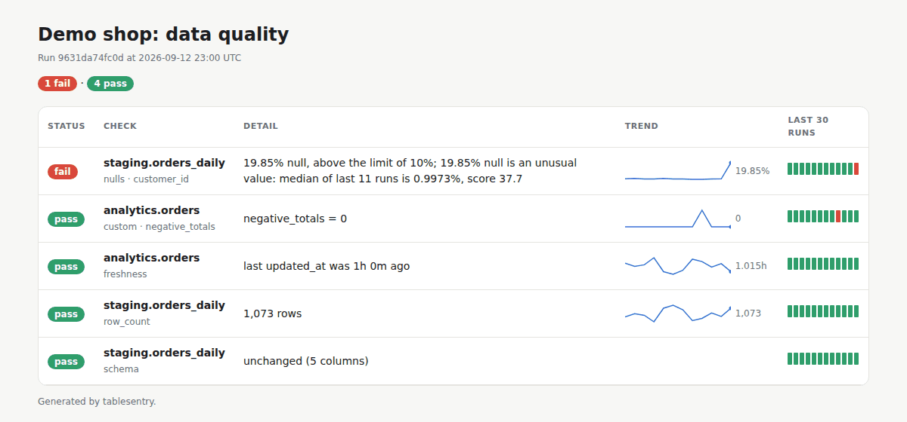
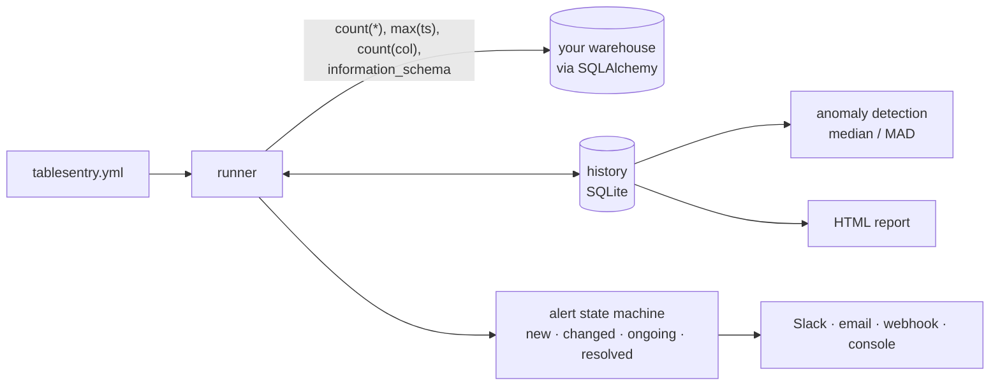

# tablesentry

**Lightweight data quality monitoring for SQL tables.** Point it at your warehouse and
describe what "healthy" means in a short YAML file. On every run it checks freshness,
volume, null rates, schema changes and your own SQL rules, learns what normal looks like,
and alerts Slack or email when something breaks, and again when it recovers.

No server, no UI to host, no vendor account. It is a Python package, a CLI and a
GitHub Action.

```bash
pip install "tablesentry[postgres]"   # or [duckdb], [snowflake], [bigquery]
tablesentry init                      # writes a commented tablesentry.yml
tablesentry validate                  # checks connections, tables and columns
tablesentry run                       # runs checks, records history, sends alerts
```



---

## What it checks

| Check | Catches | Config |
|---|---|---|
| **Freshness** | The pipeline stopped, or is late | `freshness: {column: updated_at, warn_after: 6h, max_age: 24h}` |
| **Row count** | Empty or partial loads, runaway duplication | `row_count: {min: 1000, max_change_pct: 50, anomaly: true}` |
| **Null rate** | An upstream change that stops filling a column | `nulls: {customer_id: {max_pct: 5, anomaly: true}}` |
| **Schema drift** | Columns removed, added or changing type | `schema: {}` or `schema: {allow_added: true}` |
| **Custom SQL** | Any business rule you can express as a number | `custom: [{name: no_negatives, sql: "select count(*) from {table} where total < 0", equals: 0}]` |

Each check can be `severity: warn` or `fail` (the default). Any table can take a `where:`
filter, for example to only look at the last day of a large table.

### Anomaly detection that learns

`anomaly: true` makes a check compare today's value with its own history rather than a
fixed number. It uses the **median and median absolute deviation (MAD)**, not mean and
standard deviation, so one past incident does not teach it that incidents are normal.
It stays quiet until it has `min_history` runs (default 7). Each metric has a sensible
floor, so a flat history (a null rate that is always 0%) does not turn noise into alerts.

```yaml
defaults:
  anomaly: {sensitivity: 4, min_history: 7, window: 30}
```

### Alerts that do not spam

Alert state is kept per check, so you hear about each problem once:

| Transition | Alert |
|---|---|
| pass → warn/fail/error | **new** |
| warn → fail (or back) | **changed** |
| still failing | again only after `policy.repeat_after` (default 24h) |
| problem → pass | **resolved** (turn off with `notify_resolved: false`) |

Destinations: `slack` (incoming webhook, Block Kit message), `email` (SMTP/STARTTLS/SSL),
`webhook` (a JSON POST to your own endpoint, or to a relay such as n8n, Zapier or a
small function that forwards to PagerDuty or Teams) and
`console`. Each destination picks which statuses it cares about (`on: [fail, error]`).
A broken destination is logged and never stops the run.

## Try it: the three-week demo

```bash
pip install -e ".[dev]"
python examples/demo.py
```

This builds a DuckDB warehouse for a small shop and loads it one day at a time, running
tablesentry each evening. After a week of learning, it catches five scripted incidents
and reports each one as resolved the next day, with **no false alarms** on the normal days:

```
day  9  FAIL analytics.orders:custom:negative_totals   negative_totals = 3 (expected 0)
day 10  RESOLVED analytics.orders:custom:negative_totals
day 12  FAIL staging.orders_daily:nulls:customer_id    19.85% null, above the limit of 10%; 19.85% null is an
                                                       unusual value: median of last 11 runs is 0.9973%, score 37.7
day 15  FAIL staging.orders_daily:schema               schema changed: added coupon_code
day 17  FAIL staging.orders_daily:row_count            -88.4% vs the recent median (1,027 -> 119); 119 rows is an
                                                       unusual value: median of last 16 runs is 1,022 rows, score 15.6
day 19  FAIL analytics.orders:freshness                last updated_at was 1d 1h ago (limit 1d 0h)
```
(Condensed from the demo's console output; every incident also gets a RESOLVED alert
the following day.)

## Configuration

```yaml
version: 1

connections:                       # any SQLAlchemy URL; ${VAR} and ${VAR:-default} are expanded
  warehouse: ${WAREHOUSE_URL}

timezone: UTC                      # how to read timestamps stored without a timezone
state: .tablesentry/state.db       # run history (SQLite)

defaults:
  connection: warehouse
  anomaly: {sensitivity: 4, min_history: 7, window: 30}

tables:
  - name: analytics.orders
    where: "order_date >= current_date - 7"      # optional
    checks:
      freshness: {column: updated_at, warn_after: 6h, max_age: 26h}
      row_count: {min: 1, max_change_pct: 50, anomaly: true}
      nulls:
        customer_id: {max_pct: 5, anomaly: true}
      schema: {}
      custom:
        - name: no_negative_totals
          sql: "select count(*) from {table} where total < 0"
          equals: 0              # or min / max

alerts:
  - type: slack
    webhook_url: ${SLACK_WEBHOOK_URL}
    on: [fail, error]
  - type: email
    smtp_host: smtp.example.com
    username: ${SMTP_USER}
    password: ${SMTP_PASSWORD}
    from: data-alerts@example.com
    to: [data-team@example.com]

policy:
  repeat_after: 24h
  notify_resolved: true
```

Mistakes are reported with the exact key, e.g.
`config error: tables[1].checks.row_count.min: expected a number, got 'lots'`.

## Running on a schedule with GitHub Actions

tablesentry ships as a GitHub Action. It caches the history between runs, so anomaly
detection and alert de-duplication keep working on a schedule:

```yaml
on:
  schedule: [{cron: "15 * * * *"}]
jobs:
  data-quality:
    runs-on: ubuntu-latest
    steps:
      - uses: actions/checkout@v4
      - uses: OWNER/tablesentry@v0.1.0
        with:
          config: tablesentry.yml
          extras: postgres
          report: tablesentry-report.html
        env:
          WAREHOUSE_URL: ${{ secrets.WAREHOUSE_URL }}
          SLACK_WEBHOOK_URL: ${{ secrets.SLACK_WEBHOOK_URL }}
```

See [`examples/github-workflow.yml`](examples/github-workflow.yml). It also works from
cron, Airflow (a `BashOperator`) or any scheduler: persist the `state` file between runs.

## CLI

| Command | |
|---|---|
| `tablesentry init` | Write a starter `tablesentry.yml` |
| `tablesentry validate` | Check config, connections, and that every table and column exists |
| `tablesentry run` | Run checks, record history, send alerts. `--table`, `--no-alerts`, `--json out.json`, `--report out.html`, `--fail-on warn\|fail\|error\|never` |
| `tablesentry history` | Recent runs and each check's status over time (`✓✓✓✗✓`) |
| `tablesentry report -o report.html` | Self-contained HTML report with trends |

Exit code is non-zero when the run reaches `--fail-on` (default `fail`), so it can gate
a CI pipeline.

## How it works



- **Cheap queries.** Every null check on a table runs in one scan (`count(*)` plus
  `count(col)` for each column). Nothing is copied out of the warehouse; only
  aggregates are stored.
- **Portable SQL.** Only `count`, `max` and `information_schema` are used, with a
  reflection fallback for databases without an information schema (e.g. SQLite).
  Identifiers are quoted only where the dialect needs it, so Snowflake's
  case-insensitive names keep working.
- **Fault isolation.** A failing check becomes an `error` result; the other checks and
  tables still run.

## How it compares

[Great Expectations](https://greatexpectations.io/) and [Soda](https://www.soda.io/)
are much larger frameworks, and dbt tests validate data at build time. tablesentry is
deliberately small: monitoring the tables you already have, on a schedule, with alerts
that behave well, in one config file. It suits a team that wants useful observability in
five minutes and nothing to host.

## Limitations

- No seasonality model yet: strong weekly patterns need a higher `sensitivity` or a
  `where` filter per day of week.
- Checks run one table at a time.
- The history file is local; share it between machines through CI caching or a volume.

## Development

```bash
pip install -e ".[dev]"
pytest                    # 72 tests; Postgres tests run when TABLESENTRY_TEST_POSTGRES_URL is reachable
ruff check . && ruff format --check .
```

CI runs the suite on Python 3.10 to 3.13 against DuckDB and a real Postgres, builds and
checks the package, installs the wheel in a clean environment, and runs the GitHub
Action against a test warehouse.

### Releasing

1. Bump `__version__` in `src/tablesentry/__init__.py` and update `CHANGELOG.md`.
2. `git tag v0.1.0 && git push --tags`

The release workflow checks the tag matches the version, builds, and publishes to PyPI
with **trusted publishing** (no API tokens). One-time setup: add the repository as a
trusted publisher at pypi.org → *Your projects → Publishing*, and create a GitHub
environment called `pypi`.

## License

MIT
